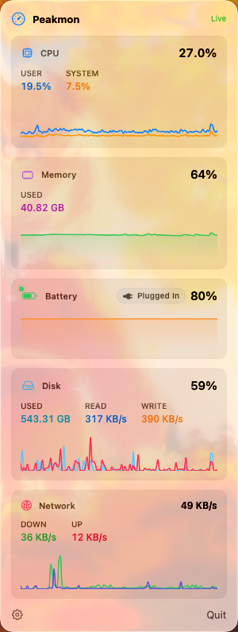
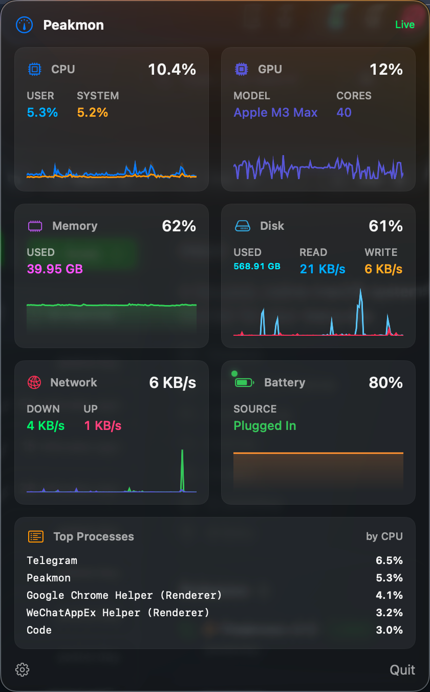
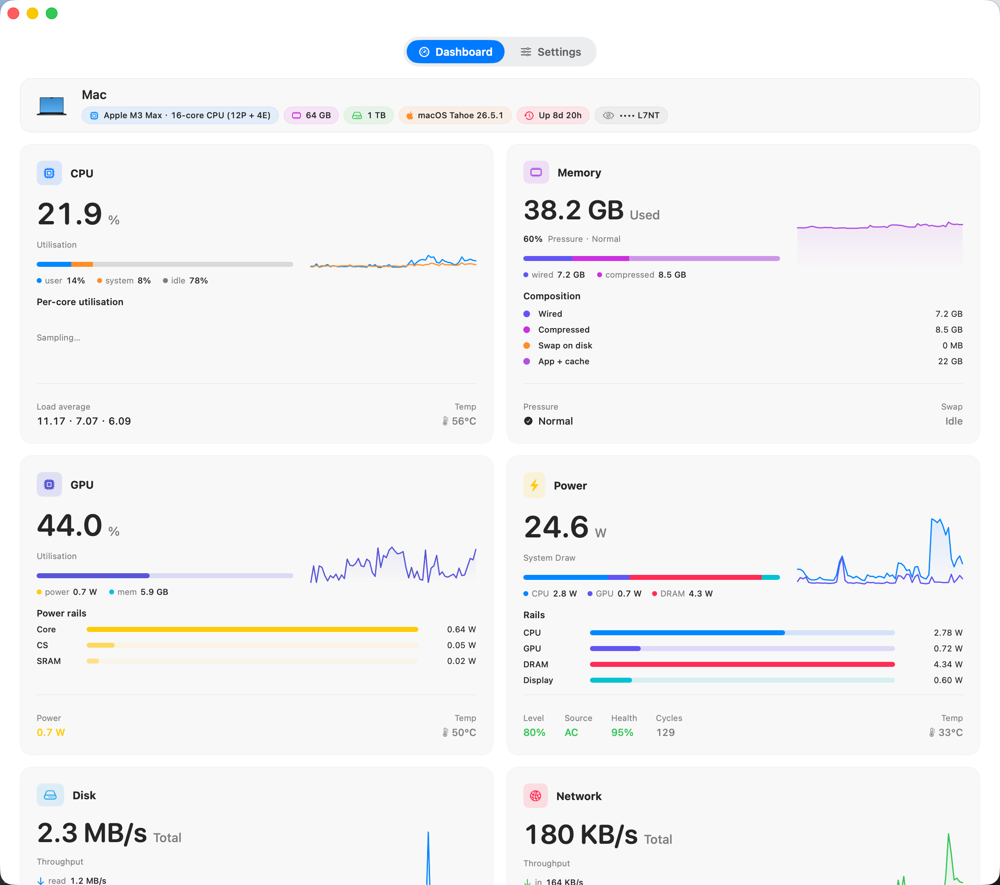
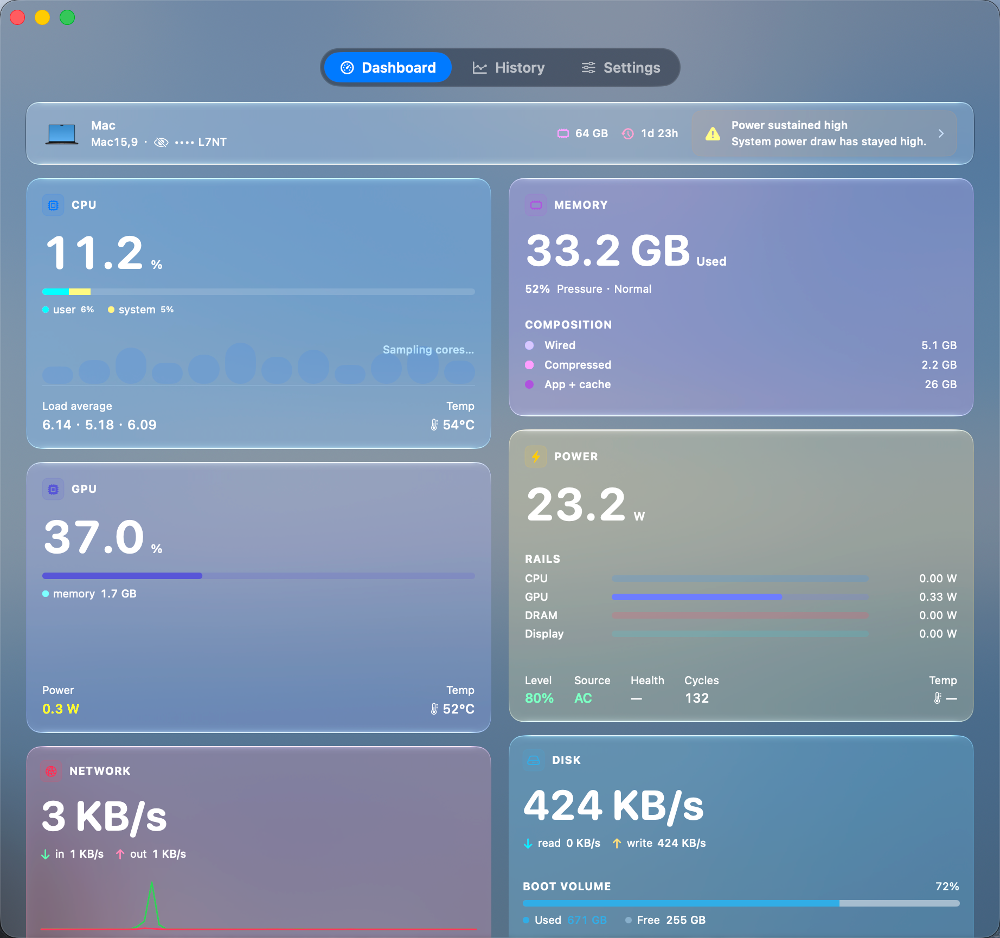

# Peakmon

[](https://github.com/crafcat7/Peakmon/releases)
[](LICENSE)

[English](README.md) · [简体中文](README.zh-CN.md)

Peakmon is a native macOS menu-bar system monitor for viewing common system metrics in the menu bar and a dashboard window.

It currently supports real-time CPU, GPU, Memory, Battery, Disk, Network, and Processes metrics. Built with SwiftUI and local Swift packages. No Electron shell, no telemetry — data is collected and displayed locally only.

<p align="center">
  
  &nbsp;&nbsp;
  
</p>

<p align="center">
  
</p>

<p align="center">
  
</p>

## Download

**[https://github.com/crafcat7/Peakmon/releases](https://github.com/crafcat7/Peakmon/releases)**

Download the latest `Peakmon.app.zip`, unzip, drop into `/Applications`. Right-click → Open on first launch to bypass Gatekeeper.

### Homebrew

```sh
brew install crafcat7/cellar/peakmon
```

## What it shows

**Menu bar** — compact segments (CPU %, memory pressure, network rate, GPU utilization, etc.) rendered as a single image. Text color adapts to the menu bar background (light / dark / full-screen).

**Popover** — click the menu bar icon for sparkline charts, per-metric stats, and a top-process list.

**Dashboard** — unified window with per-metric cards (CPU, Memory, GPU, Power, Disk, Network). Each card has headline numbers, sparkline charts, and expanded detail sections. Open via menu bar icon or global hotkey `⌃⌥⌘D`.

**Frame Rate** — a dedicated page after History for a 60-second desktop or application observation. Start and stop collection, mark moments of interest, and review the recorded trend. Collection continues when you switch pages or hide the window; finished results remain until you change the target or start again.

**Customization** — enable or disable the menu bar and popover, toggle and reorder dashboard cards, pick per-card accent colors, and choose which metrics appear in the menu bar.

## Data sources

All data stays on-device. No network requests.

| Metric | Source |
|--------|--------|
| CPU / Memory | `host_statistics64` (Darwin) |
| GPU utilization | IOAccelerator `PerformanceStatistics` (IOKit) |
| Desktop frame rate | IOReport display-coprocessor `swap` counters (Apple Silicon, when available) |
| Application frame rate | macOS 27+ `metalperftrace` aggregated Metal presentation statistics |
| Power (per-rail) | IOReport "Energy Model" (libIOReport, dlopen) |
| Temperature | SMC keys `Tp0X` / `Tg0D` |
| Fan RPM | SMC key `F0Ac` |
| Battery | IOKit `AppleSmartBattery` |
| Disk | IOKit `IOBlockStorageDriver` |
| Network | `getifaddrs` (Darwin) |
| Processes | `proc_pidinfo` (libproc) |

**Desktop observation** fixes one available display counter for the session. It prefers the built-in display; with only external displays, activity is required to identify a source. Counts from multiple displays are never added. This measures desktop presentation activity rather than the panel's configured refresh rate. A display configuration change ends the observation.

**Application observation** requires macOS 27 or newer and a readable Metal presentation source. It identifies the selected process instance and its attributable helpers, and asks you to choose a source when multiple layers are available. Data uses the original recording windows and may arrive several seconds late. The optional frame interval is the measured mean frame-on-glass interval; it is not inferred from FPS. Unsupported applications or missing data show an unavailable state, not zero. No HUD or per-frame tracing settings are changed. Results are kept in memory for the current observation and are separate from History.

## Requirements

- macOS **14.0** Sonoma or newer
- Apple Silicon recommended; Intel best-effort

## Build from source

```sh
git clone https://github.com/crafcat7/Peakmon.git
cd Peakmon
./Tools/release.sh
```

Or open `Peakmon.xcodeproj` in Xcode and press Run.

Tests:

```sh
swift test --package-path Packages/PeakmonCore
```

## Repository layout

```
Peakmon/                   # App target (menu bar + dashboard + history + frame rate + settings)
Packages/
  PeakmonCore/             # MetricKind, MetricsStore, MetricsScheduler, SMC/IOReport bridges
  PeakmonCollectors/       # System telemetry and desktop/Metal frame-rate collectors
  PeakmonUI/               # Shared views (sparkline, card templates, DashboardComponents)
```

## License

[Apache License 2.0](LICENSE)
